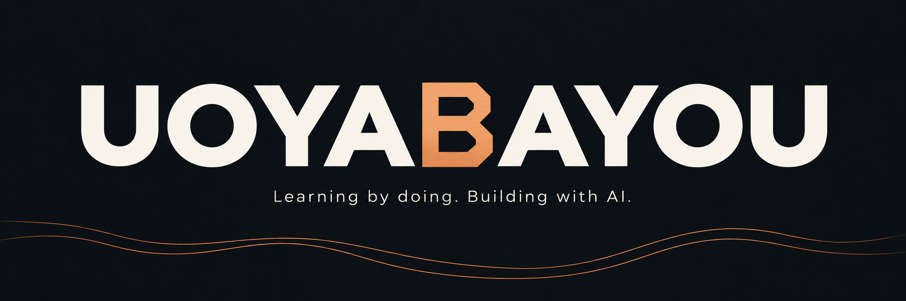

  

## Hey, I'm Bayou.

I work in beer sales and distribution, and I build practical software with AI. Most of my projects start with something I want to make easier, understand better, or stop doing manually.

### What I work on

- **Useful tools:** simplifying everyday tasks and business workflows.
- **Data and dashboards:** turning scattered information into something I can act on.
- **Automation:** connecting tools and cutting down repetitive work.

### How I build

Start with a real problem. Build a small version. Test it. Improve what works.

I'm learning by doing, with AI helping me move from an idea to working software.
